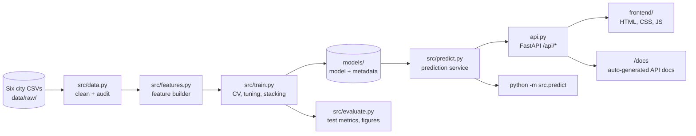

# Architecture & Project Plan

**HomeValue India**: apartment price prediction for five Indian metros, using machine learning.
Status as of 29 October 2026.

---

## 1. Project status

| Area | Status | Notes |
|---|---|---|
| Data cleaning and audit | ✅ Done | 32,963 listings → 8,076 clean rows |
| Exploratory analysis | ✅ Done | 10 figures in `reports/figures/` |
| Feature engineering | ✅ Done | Cross-fitted locality target encoding |
| Model comparison and tuning | ✅ Done | Six models, five-fold cross-validation |
| Stacked ensemble | ✅ Done | Tuned Gradient Boosting + Extra Trees → Ridge |
| Test-set evaluation | ✅ Done | 1,616 held-out listings, used once |
| Prediction service and CLI | ✅ Done | `src/predict.py` |
| REST API | ✅ Done | `api.py`, documented at `/docs` |
| Web app | ✅ Done | Estimate, EMI calculator, dashboards, method pages |
| Automated tests | ✅ Done | 14 pytest tests, all passing |
| Recent listing data | ⏳ Pending | Current dataset is a 2021 snapshot |
| Locality standardisation | ⏳ Pending | Merge variants such as "Whitefield" and "Whitefield Hope Farm Junction" |
| Property age, floor, coordinates | ⏳ Pending | Not in the source data; needs new data |
| Explainability per prediction (SHAP) | ⏳ Pending | Only global permutation importance so far |
| Public deployment | ⏳ Pending | Planned: Render or Railway with Docker |

## 2. Problem

Buyers, sellers and brokers in Indian metros usually price apartments by word of mouth and rules of thumb such as "₹ per sq ft in this locality". The goal is to predict an apartment's market price (₹) from its city, locality, carpet or super area, BHK, new-or-resale status and amenities, and to show an honest likely range so users can sanity-check a listing.

This is a **supervised regression** problem.

## 3. Architecture

### Components

| Layer | Files | Responsibility |
|---|---|---|
| Configuration | `src/config.py` | Paths, cities, amenity labels, cleaning thresholds |
| Data | `src/data.py` | Load raw CSVs, apply cleaning rules, write the audit |
| Features | `src/features.py` | Log area, area per BHK, amenity count, city one-hot, locality target encoding |
| Metrics | `src/metrics.py` | Shared error and R² functions, so every report uses the same definitions |
| Training | `src/train.py` | Compare models, tune with RandomizedSearchCV, stack, save the best model |
| Evaluation | `src/evaluate.py` | Test metrics, per-city errors, residuals, permutation importance |
| Prediction | `src/predict.py` | One code path for the API and the CLI |
| API | `api.py` | REST endpoints with input validation; serves the frontend |
| Frontend | `frontend/` | Estimate form, result, EMI calculator and dashboards; no build step |
| Tests | `tests/` | Cleaning rules, model sanity checks, API validation |

### Data flow for one prediction

1. The user picks a city and locality, and enters area, BHK, resale status and amenities.
2. The API validates the request (known city and locality, area and BHK in range).
3. The model predicts **log(₹ per sq ft)**, which is converted to a rate and multiplied by area.
4. The 80% range is the point estimate multiplied by calibrated low and high factors.
5. If the locality is unknown or has few listings, the response includes a warning and falls back to city-level pricing.

## 4. Design decisions

| Decision | Why | Alternative considered |
|---|---|---|
| **Exclude listings with all amenities coded 9** (69% of rows) | In these rows price has a log correlation of 0.21 with area, against 0.77 in rows with amenities recorded. The prices look misaligned with their listings. | Keep all rows and let the model absorb the noise, which lowers accuracy |
| **Exclude Kolkata** | Only 75 listings remain after cleaning | Train a model with a Kolkata category that has almost no data |
| **Predict price per sq ft, then multiply by area** | Matches how the market quotes prices and reduces the skew from very large prices | Predict total price directly |
| **Cross-fitted locality target encoding** | Locality has about 800 values, too many for one-hot encoding. Cross-fitting avoids leaking the target into training. | One-hot encoding, or a plain mean encoding that leaks |
| **Stacked ensemble with a Ridge meta-model** | Combines the strengths of two tree ensembles. In cross-validation it is the best model by a small margin. | A single model |
| **Calibrated 80% range from out-of-fold errors** | Gives a range that is honest about uncertainty. On the test set, 81.5% of actual prices fall inside it. | Fixed ±X% bands |
| **Single test-set evaluation** | Keeps the test result unbiased by model selection | Repeated use of the test set during tuning |
| **Plain HTML, CSS and JavaScript frontend** | No build step, easy to run and to review | Streamlit (dropped) or a JavaScript framework |
| **Save metrics and comparisons to disk** | Every report and the dashboard read the same files | Hard-coding numbers in the UI |

## 5. Methodology

1. **EDA:** listings per city, ₹/sq ft by city, price vs area, priciest localities, amenity premiums, and the data-quality audit.
2. **Feature engineering:** as in section 3.
3. **Target:** log(₹ per sq ft), with price = rate × area.
4. **Split:** 80% train and 20% test, stratified by city, `random_state=42`. The test set is used once.
5. **Models with five-fold cross-validation:** locality-average baseline, Linear Regression, Decision Tree, Random Forest, Extra Trees, Gradient Boosting, then tuning (25 candidates each for Gradient Boosting and Extra Trees) and a stacked ensemble.
6. **Metrics:** median and mean % error, share within ±10% and ±20%, R² on log and ₹ scales, MAE in ₹ lakh, and 80% range coverage.
7. **Evaluation:** test metrics overall and per city, residuals, and grouped permutation importance.

Details and numbers are in [`reports/RESULTS.md`](reports/RESULTS.md).

## 6. Success criteria and outcome

| Criterion | Target | Outcome |
|---|---|---|
| Beat the "locality average ₹/sq ft × area" baseline | Better median error | ✅ 6.9% vs 10.1% (cross-validation) |
| Median error on the test set | ≤ 10% | ✅ 6.5% overall; ✅ in four of five cities; ❌ Mumbai at 13.0% |
| R² on log price | ≥ 0.85 | ✅ 0.929 overall; ✅ in all five cities (lowest: Mumbai, 0.863) |
| Reproducible pipeline | `eda`, `train` and `evaluate` regenerate every artefact | ⚠️ Written and documented; the full pipeline was not re-run for this review |

## 7. Risks and limitations

- **Asking prices, not transaction prices.** The data is a 2021 snapshot of listings. It must be adjusted for appreciation before any real decision.
- **Coverage.** Only localities in the data are covered, and Kolkata is excluded.
- **Locality fragmentation.** The same area appears under several names, which dilutes the locality signal. Mumbai, with 235 localities and few listings each, is the most affected.
- **Missing features.** Age, floor, facing and exact location are not in the data, so the model cannot use them.

## 8. Future work

- Add recent listing or registration data, and adjust prices for time.
- Standardise locality names, then geocode them to latitude and longitude so that distance-based features become possible.
- Add floor, age and facing features.
- Add SHAP explanations for each prediction.
- Deploy with Docker on Render or Railway.
