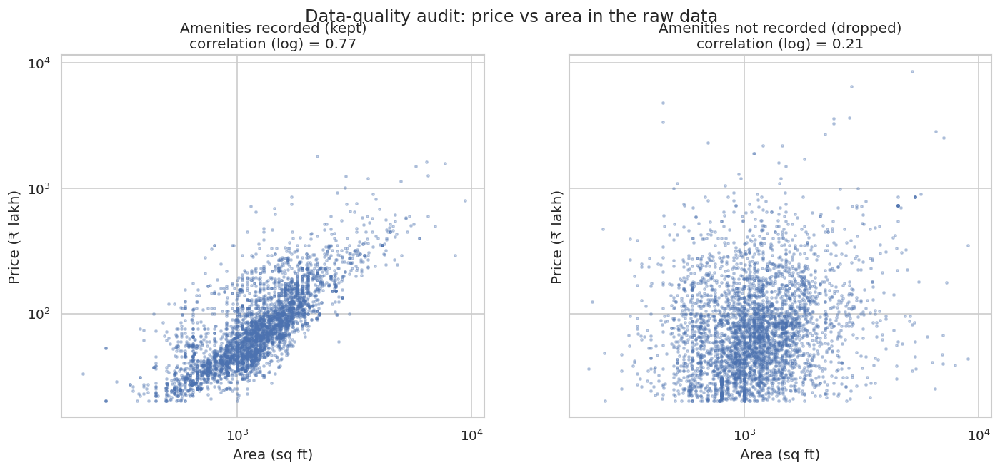
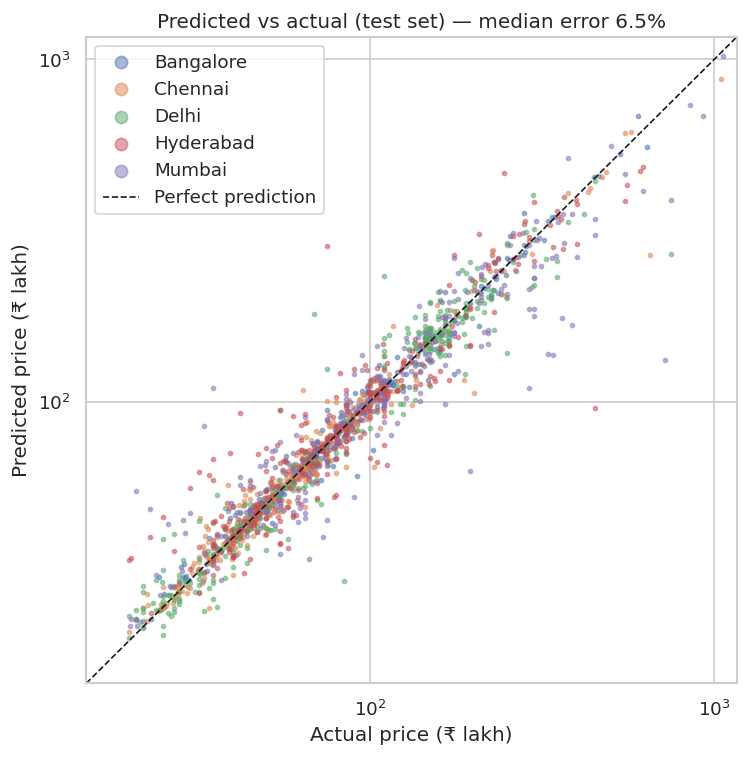

# HomeValue India

**Machine-learning price estimates for apartments in five Indian metros.**

HomeValue India predicts the market price of an apartment in Mumbai, Delhi NCR, Bengaluru, Chennai and Hyderabad from its city, locality, area, BHK, new-or-resale status and amenities. Each estimate comes with a calibrated 80% price range. The project ships as a FastAPI service and a responsive web app with an EMI calculator.

> Capstone project, B.Tech. Data: listings scraped from Makaan.com (2021 snapshot), published on Kaggle.

**Live demo:** https://homevalue-india.vercel.app (API docs at `/docs`)

---

## At a glance

| Metric (held-out test set, 1,616 listings) | Value |
|---|---|
| **Median prediction error** | **6.5%** |
| Mean absolute % error (MAPE) | 11.5% |
| Predictions within ±10% of actual | 63.1% |
| Predictions within ±20% of actual | 83.8% |
| R² on log price / on ₹ price | 0.929 / 0.869 |
| Actual prices inside the 80% range | 81.5% (target 80%) |

The full methodology, tables and caveats are in [`reports/RESULTS.md`](reports/RESULTS.md).

## Key findings

1. **Cleaning the data mattered more than tuning the model.** 69% of listings have every amenity coded `9` ("not recorded"). In those rows, price is almost unrelated to area (log correlation 0.21), against 0.77 in rows with amenities recorded. These prices look misaligned with their listings, so the project excludes them.
2. **The stacked model beats the simple market rule.** Five-fold cross-validation gives a median error of 6.9% for the stacked ensemble, against 10.1% for the "locality average ₹/sq ft × area" rule that brokers use.
3. **Area and location drive price.** Permutation importance ranks area first, then location (city and locality). Amenities and BHK matter much less.
4. **Mumbai is the hardest city.** It has 235 localities across 1,151 listings, so each locality has few examples. The median error is 13.0%, against 3.7% in Bengaluru.





## Features

- **Price estimate:** choose a city and locality (the picker shows each locality's median ₹/sq ft), set area, BHK, new or resale, and amenities. Estimates update as you change inputs.
- **Result:** price in ₹ lakh or crore with Indian digit grouping, ₹/sq ft compared with the locality median, the 80% range, and warnings for unknown or sparse localities.
- **EMI calculator:** down payment, interest rate and tenure, giving the monthly EMI and total interest.
- **Accuracy dashboard:** test metrics, model comparison, error by city and feature importance.
- **Insights and method pages:** EDA charts, the data-cleaning audit, modelling choices and limitations.
- **Light and dark themes;** works on phones.
- **REST API** with auto-generated docs at `/docs`.

## Quick start

```bash
python3 -m venv venv && source venv/bin/activate
pip install -r requirements.txt

python -m src.data        # 1. clean data and write the audit report
python -m src.eda         # 2. exploratory figures
python -m src.train       # 3. compare, tune, stack and save the model (about 5 minutes)
python -m src.evaluate    # 4. test-set metrics and figures
pytest                    # 5. run the test suite

uvicorn api:app --reload  # 6. open http://127.0.0.1:8000  (API docs at /docs)
```

The raw CSVs are already in `data/raw/`, and the trained model is in `models/`, so steps 1–3 are only needed to retrain.

### Command line

```bash
python -m src.predict --city Bangalore --locality "Whitefield Hope Farm Junction" \
    --area 1450 --bhk 3 --amenities LiftAvailable CarParking Gymnasium SwimmingPool
```

### API

```bash
curl -X POST http://127.0.0.1:8000/api/predict \
  -H "Content-Type: application/json" \
  -d '{"city":"Mumbai","locality":"Thane West","area_sqft":1050,"bhk":2,
       "resale":true,"amenities":["LiftAvailable","CarParking"]}'
```

| Endpoint | Purpose |
|---|---|
| `POST /api/predict` | Price estimate with 80% range |
| `GET /api/options` | Cities, localities and amenities for the form |
| `GET /api/model-info` | Model metadata and metrics |

## Project structure

```
├── api.py                  FastAPI: /api/* endpoints, serves the frontend
├── frontend/               index.html, styles.css, app.js (no build step)
├── src/
│   ├── config.py           paths, cities, amenity labels, cleaning thresholds
│   ├── data.py             load, clean, write the audit report
│   ├── features.py         feature builder, encoders, price-per-sq-ft model
│   ├── metrics.py          shared error and R² metrics
│   ├── eda.py              exploratory figures
│   ├── train.py            cross-validation, tuning, stacking, save model
│   ├── evaluate.py         test metrics, per-city errors, permutation importance
│   └── predict.py          prediction service and CLI
├── tests/                  pytest: cleaning rules, model sanity, API validation
├── data/raw/               the six original city CSVs
├── models/                 trained model, metadata, locality statistics, test split
└── reports/                RESULTS.md, figures/, comparison tables, cleaning audit
```

## Testing

`pytest` runs 14 tests covering the cleaning rules, model sanity checks and API input validation. All pass.

## Limitations

- **Asking prices, not sale prices.** The listings are seller asking prices from about 2021, not registered transactions. Prices need adjusting for appreciation before any real use.
- **Kolkata is excluded** because only 75 listings had reliable amenity data.
- **Only the localities in the data are covered.** Unknown localities fall back to city-level pricing.
- **Locality names are fragmented** in the source (for example "Whitefield" and "Whitefield Hope Farm Junction"), which weakens the locality signal.

See [`PLAN.md`](PLAN.md) for the architecture, design decisions and future work.

## Documentation

- [`PLAN.md`](PLAN.md): architecture, design decisions, status and future work
- [`reports/RESULTS.md`](reports/RESULTS.md): experimental results and analysis

## Data

*Housing Prices in Metropolitan Areas of India*, a Makaan.com listings dataset published on Kaggle: 32,963 listings across six metros, 40 columns. Check the dataset's licence on Kaggle before reusing the data outside this project.
